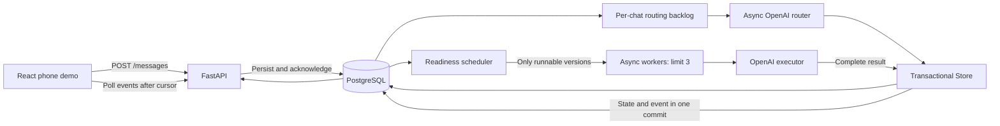

# Castle concurrent group-chat backend

CastleBot is a FastAPI backend and React phone demo for a simulated group chat. Independent requests execute concurrently through OpenAI. Follow-ups create durable task versions; dependent requests use the saved results of explicitly selected versions. Answers are published as complete, ordered chat events. The StudyBuddy demo shows this in a single mobile chat interface.

## Architecture



- `main.py`: application factory, lifespan management, typed REST API and optional CORS.
- `demo_mock.py`: deterministic demo-only router/executor, selected solely by `demo-mock-` chat IDs.
- `frontend/`: React, TypeScript and Vite phone UI, polling client, scripted controller and browser tests.
- `config.py`: environment configuration; credentials are not logged.
- `models.py`, `database.py`: async SQLAlchemy models and independent session factory.
- `crud.py`: short transactions for routing application, versions, dependency decisions, readiness, cancellation, recovery, retention and events.
- `router.py`: pure OpenAI classification with structured JSON and Pydantic validation.
- `executor.py`: modular OpenAI executor, bounded API retries, timeouts and safe errors.
- `scheduler.py`: tracked `(task_id, version)` workers, semaphores, per-chat routing and reconciliation.
- `migrations/`: additive Alembic baseline adopting the original development schema.
- `init_db.py`, `backfill_task_versions.py`: migration entry points; the latter is a compatibility wrapper.
- `cleanup_versions.py`: explicit offline retention command with preview by default.
- `scripts/check_configuration.py`: read-only DB/configuration checks and optional model metadata checks.
- `scripts/smoke_openai.py`: one opt-in minimal router request, capped at 128 output tokens with no retries.
- `scripts/smoke_demo.py`: opt-in full Alice/Bob/Jack scenario; not part of automatic verification.
- `tests/`: mocked OpenAI workflows, API, retry behavior and migration tests.
- `test_db.py`: read-only connectivity check; importing it has no database side effects.

Asyncio provides **concurrency**: several requests can be in progress while each waits for network I/O. It does not make Python CPU-bound work run in parallel. LLM requests are largely I/O-bound, so asynchronous calls allow a fast independent task to finish while another is still waiting. The default semaphore permits three executions; routing has a separate limit of three. There is no global FIFO answer queue.

This is intentionally a **single-process MVP**. Run one Uvicorn worker and one application instance per database. The Store's process-local mutation lock serializes short read/check/write transactions, never network calls. PostgreSQL chat-row locks and uniqueness constraints protect event numbering. This is not a distributed job queue or a multi-process claiming protocol.

## Installation and configuration

Python 3.11+ and PostgreSQL are required for the application. Validation was performed with Python 3.13. SQLite is supported for isolated local tests.

```bash
python3 -m venv .venv
source .venv/bin/activate
pip install -r requirements-dev.txt
# Only create .env if it does not already exist:
test -f .env || cp .env.example .env
```

Set `DATABASE_URL` and `OPENAI_API_KEY` in `.env`. Keep that file private. The database URL uses the `postgresql+asyncpg://` scheme. The key must have access to the selected models.

For a new local development database, one possible setup is:

```bash
psql postgres -c "CREATE ROLE castle WITH LOGIN PASSWORD 'castle';"
createdb -O castle castle_agent
```

The sample password is for a local demonstration only. Alternatively, use an existing PostgreSQL role and database and put its matching URL in `.env`. Do not recreate an existing database.

| Environment variable | Default / purpose |
| --- | --- |
| `DATABASE_URL` | PostgreSQL async connection URL; set it for your installation |
| `OPENAI_API_KEY` | Required for real routing and execution |
| `LLM_PROVIDER` | `openai` (the only configured provider) |
| `EXECUTOR_MODEL` | `gpt-6.1-terra` |
| `ROUTER_MODEL` | `gpt-6-luna` |
| `ROUTER_REASONING_EFFORT` | `none`, to minimize classification latency and cost |
| `EXECUTOR_REASONING_EFFORT` | `low`; increase to `medium` for harder synthesis |
| `ROUTER_MAX_OUTPUT_TOKENS` | `700`, including reasoning if enabled |
| `MAX_CONCURRENT_AGENTS` | `3` simultaneous task executions |
| `MAX_CONCURRENT_ROUTES` | `3` simultaneous routing calls across chats |
| `API_TIMEOUT_SECONDS` | `60` per provider attempt |
| `TASK_TIMEOUT_SECONDS` | `240` total execution/routing budget, including retries |
| `MAX_RETRIES` | `2`, in addition to the initial provider attempt |
| `RETRY_BASE_SECONDS` | `1`, exponential backoff with bounded jitter |
| `MAX_OUTPUT_TOKENS` | `4096`, including reasoning; incomplete answers fail explicitly |
| `CONTEXT_MESSAGES` | `30`, each truncated to 2,000 characters |
| `CONTEXT_TASKS` | `20`, each routing instruction truncated to 4,000 characters |
| `RETENTION_DAYS` | `30` |
| `SCHEDULER_INTERVAL_SECONDS` | `0.5`; completions/messages also wake the scheduler |
| `ROUTING_STRUCTURED_OUTPUT` | `true`; strict JSON schema, followed by local validation |
| `CORS_ORIGINS` | Empty list; JSON list such as `["http://localhost:5173"]` for a separate local UI |
| `DEMO_EXECUTION_DELAY_SECONDS` | `0`; optional 0–30 second pre-execution delay for `demo-live-` chats only, to make overlap visible |

OpenAI calls use the official `AsyncOpenAI` SDK and `client.responses.create`. Requests set `store=False`, Standard service tier, explicit output budgets and role-specific reasoning effort. SDK retries are disabled so application retry bounds remain predictable. Connection errors, timeouts, HTTP 408/409/429 and 5xx responses are retried; known exhausted-credit/quota errors and other nontransient errors fail immediately. Provider response bodies and credentials are not stored in failure events. The router uses strict [`text.format` JSON schema](https://developers.openai.com/api/docs/guides/structured-outputs), then Pydantic validation and database reference checks. Unsupported schema/model settings fail explicitly without a second paid fallback. If a compatible custom model needs plain JSON, set `ROUTING_STRUCTURED_OUTPUT=false`; local validation still applies. Refusals, empty outputs and incomplete responses are rejected safely. Commentary output is excluded from final answers.

Configuration always reads `.env` from the repository root, regardless of the working directory. Exported environment variables take precedence. Inspect non-secret effective settings and conflicting overrides with:

```bash
python -m scripts.check_configuration
python -m scripts.check_configuration --models
```

The second command checks model metadata without generating tokens. It verifies model visibility, not inference permission or available billing credit. Only `OPENAI_API_KEY` is used; any old Anthropic credentials retained in your private `.env` are ignored. `ROUTER_MODEL` and `EXECUTOR_MODEL` replace the former `ROUTING_MODEL` and `EXECUTION_MODEL` names. Restart the server after changing configuration.

OpenAI API usage is metered and managed through API Platform billing separately from the ChatGPT application subscription. Do not assume a ChatGPT subscription provides unlimited API usage. Eligible subscriptions can claim [API credits](https://developers.openai.com/api/docs/guides/chatgpt-api-credits); those credits must be activated for the correct API organization.

### Model selection and estimated costs

Reviewed against official model, pricing and deprecation documentation on November 4, 2026. No paid comparative benchmark was run; these are cost/role recommendations, not measured quality rankings.

| Role / alternative | Model | Standard input / 1M tokens | Output / 1M tokens | Decision |
| --- | --- | --- | --- | --- |
| Router | [`gpt-6-luna`](https://developers.openai.com/api/docs/models/gpt-6-luna) | $0.10 | $0.50 | Efficient focused classification, strict structured output, reasoning `none` |
| Executor | [`gpt-6.1-terra`](https://developers.openai.com/api/docs/models/gpt-6.1-terra) | $1.00 | $5.00 | Quality/cost balance for reasoning, writing and synthesis, reasoning `low` |
| Lower-cost executor alternative | [`gpt-5.4-mini`](https://developers.openai.com/api/docs/models/gpt-5.4-mini) | $0.75 | $4.50 | Compatible with Responses, structured output and low reasoning; not benchmarked here |

Both selected models support Responses and structured outputs. GPT-5 mini/nano were considered but are [scheduled to shut down December 11, 2026](https://developers.openai.com/api/docs/deprecations), so they are unsuitable new defaults. GPT-5.6 Luna ($0.20/$1.20) costs more per token than the selected router. Larger Sol/Astra models cost more and are unnecessary defaults for this portfolio project. For the lowest possible ongoing budget, you can explicitly change `EXECUTOR_MODEL` to `gpt-6-luna`, accepting the smaller model for harder synthesis; no automatic model escalation occurs.

Illustrative uncached Standard usage: a route with 2,000 input + 150 output tokens costs **$0.000275**. An execution with 3,000 input + 1,000 total billed output tokens costs **$0.008**. One route plus one execution is about **$0.0083**, or **$8.28 for 1,000 such requests**. These are estimates from [published prices](https://developers.openai.com/api/docs/pricing), excluding retries, extra task versions, tools and regional premiums. Billed output includes hidden reasoning tokens; 1,000 visible tokens plus reasoning will cost more than this example. Cache hits can reduce input cost; explicit cache writes have their own rates. No external tools or premium service tier are enabled.

The executor has **no external tools**: no browser, live financial data or file access. Its instructions explicitly require honest limitations instead of fabricated research or citations. Conversation and prerequisite data are treated as untrusted input.

## Database initialization and migration

Stop any old application process before migrating. Back up important development data first using your usual PostgreSQL backup procedure.

```bash
source .venv/bin/activate
python init_db.py
# Equivalent:
alembic upgrade head
alembic current
```

The `0001_versioned_backend` migration handles both an empty database and the original `tasks`, `messages`, and optional `task_versions` tables. It adds columns and tables without deleting existing rows, backfills missing current versions, updates the current version snapshot from the original authoritative `tasks` row, preserves historical versions, and assigns deterministic message sequences. Existing messages are not rerouted, and old completed results are not republished. Unrecoverable revisions previously overwritten by the old implementation cannot be reconstructed.

Legacy `tasks.content/status/result` columns remain synchronized compatibility snapshots. New execution logic reads only `task_versions`. This avoids a destructive rewrite of existing development data. Alembic records the applied migration, so rerunning initialization is safe. Destructive downgrade is disabled; restore a backup to roll back. Future schema changes need new migrations.

| Table | Responsibility |
| --- | --- |
| `tasks` | Logical identity, original message, chat, owner, current `version` pointer |
| `task_versions` | Composite primary key `(task_id, version)`; instructions, source message, status, result, sanitized error, attempt count, execution token and timestamps |
| `task_dependencies` | Exact dependent and prerequisite versions, both protected by composite foreign keys |
| `dependency_decisions` | Persisted original/updated offers, owner-associated dependent, choice and resolution timestamps |
| `messages` | Every submitted message, per-chat message sequence and durable routing state |
| `chat_states` | Durable counters for message and event sequence allocation |
| `chat_events` | Immutable outbox: event ID, per-chat sequence, bot identity, task/message/version links and payload |

The current version pointer is maintained by the Store transaction. A conservative logical-task DAG rejects cycles, including cross-version self-dependencies. This may reject a historical graph that would be acyclic when considered only by exact version; simplicity is preferred for the MVP.

## Start the backend

```bash
source .venv/bin/activate
python init_db.py
uvicorn main:app --host 127.0.0.1 --port 8000 --workers 1
```

Open `http://127.0.0.1:8000/docs` for the generated OpenAPI interface. Liveness is `/health`; `/db-health` returns HTTP 503 when the database cannot be reached. To check connectivity without starting the server:

```bash
python test_db.py
```

Initialization never runs retention cleanup. API startup requires the migrated schema and recovers interrupted work. No credentials are required to run the mocked tests.

## StudyBuddy phone demo

In another terminal, start the React UI:

```bash
cd frontend
npm install
npm run dev
```

Open [http://127.0.0.1:5173](http://127.0.0.1:5173). Vite proxies `/api` to FastAPI at `127.0.0.1:8000`, so no browser API key or CORS setting is needed for the local setup. Start PostgreSQL and the backend first. Use one Uvicorn worker. The demo does not delete or reuse earlier chats; every Start/Restart creates a fresh chat ID.

The phone starts in **Mock preview**. Press **Start Demo** to play the main StudyBuddy conversation. The header’s `•••` menu selects the main, cancellation or ambiguous-follow-up scenario; it also provides pause, next-message, restart and mode controls. At Jack’s version question, choose either original or updated. **Next Message** selects updated as the scripted default. After playback, use the participant picker and composer to send manual messages in the same chat.

**Mock preview** uses `demo-mock-` chat IDs. The real router, scheduler, task versions, database, dependency decisions, cancellation and event publication still run; only model routing and answer generation use deterministic fixtures. These replies are labeled as mock in the phone. **Live OpenAI** uses `demo-live-` chat IDs and the configured `OPENAI_API_KEY`, `ROUTER_MODEL` and `EXECUTOR_MODEL` on FastAPI. It is available only when the backend reports a key. Selecting live mode does not incur model usage; requests begin after Start Demo or a manual `@CastleBot` message. Set `DEMO_EXECUTION_DELAY_SECONDS=6` in the backend environment if you want a more visible live overlap, then restart FastAPI. Normal chats are unaffected by this delay.

The human messages are scripted so every viewer sees the same conversation and can reproduce the timing. They are saved through `POST /messages`; ordinary chat never invokes CastleBot. Mentioned messages enter the real asynchronous task lifecycle. The UI polls saved message/task/decision state and the durable event stream with cursors, deduplicates event IDs, and renders published answers as Markdown. It shows overlap, Jack’s dependency wait, Alice’s version 2, the version choice, and the final pitch from selected saved results. The two shorter scenarios show actual cancellation status and a clarification prompt that can be answered with a more specific message.

Run routine tests without model charges:

```bash
source .venv/bin/activate
pytest -q
cd frontend
npm test
npm run build
# For browser tests, start a local backend with a disposable test database first:
npm run test:e2e
```

Browser tests use installed Chrome and expect FastAPI at `127.0.0.1:8000`; use an isolated database and empty `OPENAI_API_KEY` for mock-only runs. The test command starts Vite if needed. Captures: [completed conversation](frontend/screenshots/studybuddy-phone.png) and [390 × 844 welcome screen](frontend/screenshots/studybuddy-mobile-welcome.png).

For controlled paid verification, run `python -m scripts.smoke_openai --live` (one routing request) and, only after that succeeds, `python -m scripts.smoke_studybuddy --live` (one StudyBuddy run with a hard cap of 15 model requests and no retries). The full check uses a temporary database and leaves your development data untouched. Do not run it as part of automated tests.

This is a local portfolio demo. Its participant IDs are illustrative rather than authenticated users. The UI polls rather than streaming tokens, does not implement request-idempotency keys, and does not include deployment or mobile messaging integration. If the model routes an ambiguous live message differently, the app displays the actual outcome instead of inventing a clarification.

## Task lifecycle and revisions

1. `POST /messages` persists the message and returns HTTP 202. Ordinary messages stay `stored_no_action` and never invoke OpenAI.
2. Mentioned messages enter the persistent routing backlog. Routing is ordered within each chat, so a rapid follow-up can see the earlier task. Different chats route concurrently.
3. The router produces `new_task`, `follow_up`, `dependent_task`, or `clarification`. Context is bounded and chat-scoped. The Store revalidates task IDs, ownership, cycles and message state transactionally. Invalid references become clarification requests rather than unintended work.
4. A task version is `queued`, `waiting_for_dependencies`, or `waiting_for_decision`. Only queued versions can claim a worker slot. Every prerequisite must be successfully completed, and its actual saved result is supplied to OpenAI.
5. A claimed version becomes `running`, with a fresh execution token. Completion checks status and token in the same serialized transaction that stores its result and event. Final states are `completed`, `failed`, or `cancelled`.
6. A follow-up appends its instructions into a new immutable instruction snapshot and advances the logical pointer. The original message association is preserved. Only the task owner can revise it; other users can create dependent tasks.
7. When a prerequisite changes, current dependents—including already completed ones—receive a durable decision request. In-flight dependent runs are paused and invalidated. A completed result is retained while its owner decides.
8. `keep_original` keeps the exact selected version and resumes work, or reuses an existing result. `use_updated` creates a new dependent version with the selected new prerequisite. Other pending questions move to that new current dependent version, and its own dependents are notified. Repeated upstream revisions update an unresolved offer to the latest version; the original selection remains fixed.
9. Superseded work is cancelled only when it is outside the transitive set of needed versions. Historical work required by another active task or unresolved choice can complete and save its result, but cannot publish a new standalone answer as current.

Execution tokens also reject late results from an interrupted attempt of the **same** version. Existing published events are never edited. If a follow-up arrives after a response was already committed, that response remains part of the conversation history.

Explicit cancellation applies to the logical task's **current version**, even when other tasks depend on it. Dependents that selected that version fail explicitly; dependents awaiting a version choice remain paused until the choice is resolved. Historical versions still needed elsewhere are independent of that cancellation. Cancelling a dependent dismisses its pending decisions and can release unneeded historical work. Repeating cancellation is idempotent; cancelling a finished task returns 409. A follow-up can create a fresh version after failure or cancellation.

On shutdown, worker attempts are invalidated and returned to `queued` when still appropriate. On startup, interrupted `running` versions and `routing` messages are requeued; waiting dependencies and decisions remain persisted. A crash after a provider response but before database commit may cause another billable generation. Answers are deduplicated by task/version; provider execution is not exactly once. Reconciliation also reclaims orphaned running rows after transient completion-write failures.

## REST contract for the frontend

| Method and path | Purpose |
| --- | --- |
| `POST /messages` | `{chat_id, user_id, content}` → 202 `{message_id, task_id: null, status}` |
| `GET /messages/{message_id}` | Poll routing status and the eventual task association |
| `GET /tasks/{task_id}` | Current version, result/error, dependencies and pending decisions |
| `GET /tasks/{task_id}/versions` | Version history; `after_version=0&limit=100` |
| `GET /tasks/{task_id}/versions/{version}` | Exact saved version and dependencies |
| `GET /chats/{chat_id}/messages` | Submitted participant messages; `after=0&limit=100` |
| `GET /chats/{chat_id}/tasks` | Chat tasks; `offset=0&limit=100` |
| `GET /chats/{chat_id}/events` | Bot outbox; `after=0&limit=100` → `{events, next_cursor}` |
| `GET /chats/{chat_id}/decisions` | Up to 200 pending dependency choices |
| `POST /tasks/{task_id}/cancel` | Cancel current version; returns the task |
| `POST /dependency-decisions/{decision_id}/resolve` | `{user_id, choice: "keep_original" or "use_updated"}` |
| `GET /demo-config` | Mock/live availability and optional live demo delay |
| `GET /health`, `GET /db-health` | Liveness and database connectivity |

Limits on paginated endpoints are 1–200. Task-list offset ordering is stable by ID but is not a snapshot during concurrent inserts. Task history exposes the original message separately as `original_message_id`. Because routing is asynchronous, the earlier synchronous `POST /messages` task-ID response is now available through message polling and events. Core existing paths and HTTP 202 acceptance remain compatible.

Event types are `agent_answer`, `task_status`, `clarification_request`, `dependency_decision_request`, and `failure_notification`. All use `bot_id: "CastleBot"`. Answer payloads contain `content`; status/failure payloads contain status/error or routing-stage information. A task status event includes whether that version was current at the time of publication. Decision events include `decision_id`, versions, recipient `user_id` and a question. Query the decisions endpoint for the latest offer before displaying/resolving an old cached event.

Store the last consumed `sequence` per chat. Fetch with `after=<cursor>` and apply each `event_id` once, then save `next_cursor`. Retrying the same cursor is safe: events are immutable, ordered and uniquely identified. Completion and answer insertion are one transaction. Repeating the same decision choice returns the stored resolution; a conflicting choice returns 409. Resubmitting a message creates a new message; HTTP request idempotency keys are not implemented.

Participant history and bot events are separate streams. A frontend should display both, keeping each stream's cursor. Text is plain text and untrusted; escape it or use a safe Markdown renderer. A clarification is answered by sending a new, more explicit `@CastleBot` message.

## Alice, Bob and Jack demonstration

```bash
curl -s http://127.0.0.1:8000/messages -H 'Content-Type: application/json' \
  -d '{"chat_id":"demo","user_id":"alice","content":"@CastleBot explain NVIDIA’s business model"}'
curl -s http://127.0.0.1:8000/messages -H 'Content-Type: application/json' \
  -d '{"chat_id":"demo","user_id":"bob","content":"@CastleBot explain AMD’s business model"}'
curl -s http://127.0.0.1:8000/messages -H 'Content-Type: application/json' \
  -d '{"chat_id":"demo","user_id":"jack","content":"@CastleBot compare Alice’s and Bob’s findings"}'
curl -s http://127.0.0.1:8000/messages -H 'Content-Type: application/json' \
  -d '{"chat_id":"demo","user_id":"alice","content":"@CastleBot actually focus on NVIDIA’s data-center business"}'

curl -s http://127.0.0.1:8000/chats/demo/decisions
curl -s http://127.0.0.1:8000/chats/demo/events?after=0
# Substitute the decision_id returned above:
curl -s http://127.0.0.1:8000/dependency-decisions/DECISION_ID/resolve \
  -H 'Content-Type: application/json' -d '{"user_id":"jack","choice":"keep_original"}'
# Or use "use_updated" on a pending decision in another run.
```

Alice and Bob execute independently. Jack waits without using an execution slot. Alice's change creates version 2; Jack selects Alice v1 or v2 while retaining Bob's selected version. Once both selected results exist, Jack receives them as execution input. Poll `/chats/demo/events` for coherent full answers.

For a controlled live authentication/compatibility check, use the one-request smoke command:

```bash
python -m scripts.smoke_openai --live
```

It sends one short classification input to the configured router model, caps output at 128 tokens, validates the structured decision, and disables retries. It does not start the scheduler, touch the database or run the executor. A failed billing/permission request is reported without repeating it. Model-list access alone does not establish inference access.

The legacy `python -m scripts.smoke_demo --live --choice keep_original` / `--choice use_updated` backend checks remain available. They make multiple billable calls against the configured database and may recover interrupted work. For the bounded StudyBuddy check, use the temporary-database `scripts.smoke_studybuddy` command described above.

## Tests and verification

```bash
source .venv/bin/activate
pytest -q
python -m compileall -q main.py config.py database.py models.py crud.py router.py executor.py scheduler.py migrations scripts tests
```

The default suite uses a fresh temporary SQLite database for every workflow and mocks every OpenAI call. Migration tests create temporary legacy databases and verify preservation and repeated upgrade. The original database experiment no longer writes on import.

For real PostgreSQL integration tests, create a **separate** empty database whose name starts with `castle_test_`:

```bash
createdb castle_test_backend
TEST_DATABASE_URL=postgresql+asyncpg://YOUR_USER@localhost/castle_test_backend pytest -q
```

The fixture rejects the configured development URL and any database name without the required prefix. Each test creates and drops only a random `test_<uuid>` schema inside this test database. Do not set `TEST_DATABASE_URL` to a database containing valuable data. No test makes live API calls. PostgreSQL integration validates the same workflows as SQLite, including both REST decision paths.

Coverage includes ordinary messages, new tasks, actual overlap and semaphore limits, queued/running cancellation, revisions and concurrent revisions, retained historical completion, stale run tokens, multi-prerequisite waiting/results/failures, both decision choices, running/completed dependent revision, transitive retention, invalid references and ownership, cycles, restart recovery, publication ordering and deduplication, retention protection, rate limits/timeouts, structured output, refusals and incomplete responses, REST contracts and additive migration.

The implementation verification record is in `VERIFICATION.md`, including any environment blockers. Passing mocked scenarios does not by itself verify API credentials or model access.

## Retention maintenance

Stop the server before offline maintenance, then preview:

```bash
python cleanup_versions.py
# Only after reviewing the preview:
python cleanup_versions.py --apply
```

Current versions, active versions, unresolved decision participants and referenced prerequisite versions are protected. Expired terminal historical **leaves** may be deleted. This is intentionally conservative: even retained terminal dependents protect their prerequisite versions. Another cleanup pass can remove an ancestor after its expired dependent leaf has been deleted. Resolved decision rows whose foreign keys would otherwise block cleanup are removed; their event audit remains. Messages and chat events are not deleted. No destructive cleanup runs during initialization or tests unless an isolated test explicitly invokes it.

## Limitations and production improvements

- One application process only. The in-process lock and live-worker map do not support multiple Uvicorn workers, multiple machines, or simultaneous offline maintenance. A production design needs database job leases/claims and a coordinated publisher.
- No authentication: user IDs are supplied by the simulator. Owner checks enforce consistency within that simulation, not proof of identity. Bind locally; authentication, authorization, rate limiting and quotas are prerequisites for public deployment.
- Recovery may repeat provider work. There is no durable provider-side exactly-once execution or retry schedule across repeated process crashes.
- Readiness reconciliation scans the retained task graph. This is clear and practical for an MVP; indexed incremental unblocking and bounded historical queries would be needed at large scale.
- Context is bounded, not long-term memory. Ambiguous/older references may require clarification. Repeated follow-ups and large prerequisite results can still exceed model context; those calls fail explicitly rather than silently dropping prerequisites.
- Dependency decisions have no expiry. Repeated upstream revisions refresh the pending offer; an API submission applies to the latest persisted offer at transaction time. A future UI can add optimistic offer tokens if it needs strict stale-screen rejection.
- No external search, market feeds, file tools, streaming, WebSockets, or Telegram/Discord/Slack integration. Tool integration can be added behind the executor interface.
- Retention is offline and conservative. Event/message retention, authentication, metrics, deployment migrations, backups and distributed worker leases remain production work, not hidden MVP infrastructure.
